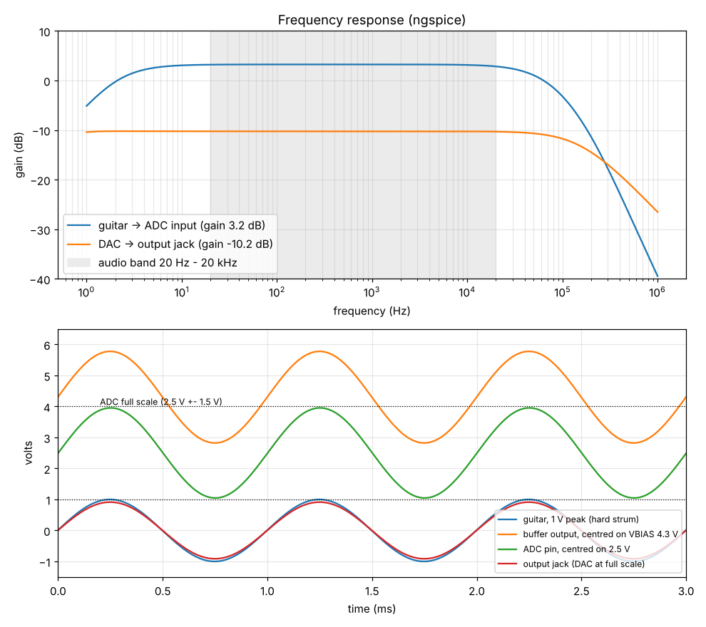
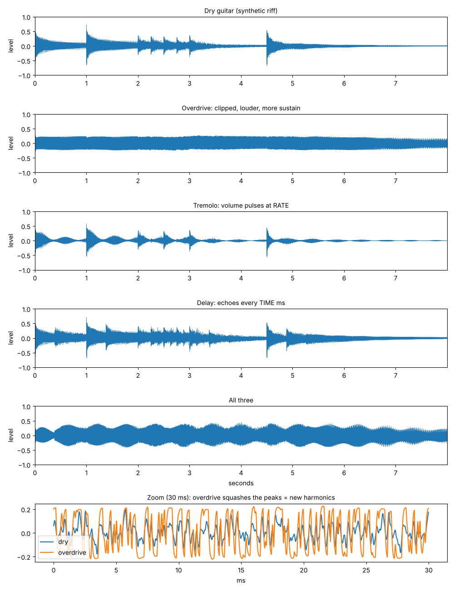

# Design notes: how the pedal works

This explains each block from the guitar to the amp, with the numbers that
set each part's value. Read it next to `hardware/fab/schematic.pdf`; the sheet
names below match the schematic pages.

## 1. Power (sheet "power")

```
9 V adapter -> D1 (SS34) -> +9V ---- op-amp, VBIAS divider
                              |
                              +-> U1 L78M05 -> +5V -+-> FB1 -> +5VA (ADC analog supply)
                                                    +-> U2 AP2112 -> +3V3A (ADC digital, DAC)
                                                    +-> D2 (SS14) -> Black Pill "5V" pin
```

* **D1** is in series with the input. If you plug in a wrong (centre-positive) adapter, it blocks the current instead of burning the board. It costs about 0.4 V, so +9V is about 8.6 V.
* **U1 (5 V regulator)**: the ADC wants a clean 5 V for its analog side. **FB1** (a ferrite bead) stops high-frequency noise from the digital parts getting into that supply.
* **U2 (3.3 V regulator)**: a separate, quiet 3.3 V just for the two converters. The Black Pill makes its own 3.3 V for the microcontroller.
* **D2** feeds the Black Pill from our 5 V. When you plug in USB, it stops the USB 5 V flowing back into the pedal. (That is also why the guide says: power the pedal with 9 V before you plug USB into a Black Pill that sits in the sockets. Otherwise the converters are unpowered while the microcontroller drives clock signals into them.)
* **VBIAS = 4.3 V**: R1 and R2 (10k each) split +9V in half, and C8 (47 uF) holds it steady. The op-amps run on one supply (0 to 9 V), so the audio is centred on 4.3 V instead of 0 V. VBIAS is the "audio zero".

## 2. Input stage (sheet "input")

```
jack tip -> C9 100nF -> R4 1k -> op-amp (+) ... gain 1 + R6/R7 = 1.51 ... -> R8 1k / C13 2.2nF -> C14 -> ADC
             R3 1M to GND     C10 100pF      R5 1M to VBIAS
```

* **R3 (1 M to ground)** keeps the input at 0 V when nothing is plugged in, so you don't get a pop when you plug in.
* **C9** blocks DC. **R5 (1 M to VBIAS)** gives the op-amp's input its 4.3 V centre. A guitar pickup wants to see about 1 MOhm, and R3 in parallel with R5 is 500 kOhm, which is close enough. Pickups sound duller into much less.
* **R4 + C10** is a low-pass filter at 1.6 MHz that keeps radio stations out.
* **Gain = 1 + R6/R7 = 1 + 5.1k/10k = 1.51** (+3.6 dB). C12 in series with R7 means the gain only applies to AC. For DC the op-amp is a plain follower, so its output stays at VBIAS.
* **R8 + C13 is the anti-alias filter**: -3 dB at 1/(2 pi x 1k x 2.2n) = 72 kHz. The ADC's own digital filter does the steep cut at 24 kHz.
* **C14** blocks the 4.3 V. The PCM1808 centres its input at 2.5 V by itself.

**Simulated (ngspice, with a 10 kOhm pickup):** gain x1.45 at 1 kHz (the 10k pickup and the ADC's 60k input lose a little). -3 dB at 2.2 Hz and 59.6 kHz. A hard strum of 1 V peak becomes 2.9 V peak-to-peak at the ADC, just inside its 3.0 V full scale.



## 3. ADC: PCM1808 (sheet "adc")

* 24-bit stereo ADC; only the left input is used. The right input is tied to ground through C15, so it stays quiet.
* **MD0 = MD1 = 0: slave mode.** The STM32 makes all the clocks. **FMT = 0: I2S format.**
* Full scale: 3.0 V peak-to-peak (0.6 x the 5 V supply).
* VREF is decoupled with 10 uF + 100 nF (C16, C17), as the datasheet asks.

## 4. Clocks and I2S (sheets "mcu", "test")

The STM32's I2S2 peripheral is the "conductor":

| Signal | Pin | Frequency | Test point |
|---|---|---|---|
| MCLK (master clock) | PA3 | 12.29 MHz = 256 x fs | TP7 |
| BCK (bit clock) | PB13 | 3.07 MHz = 64 x fs | TP8 |
| LRCK (word clock) | PB12 | 47 991 Hz = fs | TP9 |
| DAC data out | PB15 | | |
| ADC data in | PB14 (I2S2ext) | | |

The clock tree: the 25 MHz crystal goes to the PLL I2S block: 25/25 x 258 / 3 = 86 MHz. Then 86 MHz / (256 x 7) = 47 991 Hz, which is 0.02 % below 48 kHz. Nobody can hear that.

R15 to R18 (33 Ohm) sit in series with the fast clock lines. They soften the edges, so there is less ringing and less noise radiated into the audio.

## 5. Firmware (`firmware/src`)

```
DMA (ADC -> RAM)  --half full / full interrupt-->  audio_cb(): 32 samples in -> pedal_process() -> 32 samples out
DMA (RAM -> DAC)  <------------------------------  (ping-pong buffers, 0.67 ms per block)
main loop: every 5 ms read knobs + switches, set LEDs; every 0.5 s print status on the UART
```

* **Ping-pong buffers**: while the DMA fills one half of a buffer, the CPU works on the other half. The buffers add about 1.3 ms of delay from input to output, and the two converters' digital filters add about 1 ms more. You can't hear 2 ms.
* **Knobs**: ADC1 scans the six pots continuously into memory (DMA2). The DSP smooths each value (20 Hz low-pass) so turning a knob never makes zipper noise.
* **Footswitches**: momentary switches to ground, internal pull-ups, 20 ms debounce in software (plus R + 100 nF on the board). Each press toggles that effect.
* **Mute**: PB9 drives the DAC's XSMT pin. R9 keeps it low (muted) until the firmware has started the clocks, so there is no pop at power-on.
* **Boot modes** (hold a footswitch while you power up): OD = 440 Hz test tone; DELAY = straight passthrough with no effects. These are for bring-up.
* **Crash handler**: if the code ever faults, the Black Pill's blue LED blinks fast.

## 6. The effects (`firmware/dsp/effects.c`)

All in 32-bit floating point (the F411 has a hardware FPU), at 48 kHz, in this order:

**Overdrive**
1. Cut some bass before clipping (a low-pass at 300 Hz, of which 75 % is subtracted). That keeps the low strings from turning to mud.
2. Gain = 1 + 150 x DRIVE^2 (1x to 151x).
3. Soft clipping: y = x(27 + x^2) / (27 + 9x^2). This rounds the peaks smoothly, like a tube, instead of chopping them flat. The rounding adds the harmonics you hear as "drive". THD goes from 0.6 % at minimum drive to 38 % at maximum.
4. TONE: a low-pass from 800 Hz to 8 kHz.
5. Level = 0.7 / (1 + 0.03 x gain), so turning up DRIVE doesn't make it much louder. A DC blocker removes any offset from the clipping.

**Tremolo**: the volume is multiplied by an LFO (a slow sine), rate 0.5 x 24^RATE Hz = 0.5 to 12 Hz. DEPTH sets how far the volume dips (0 to 100 %). The yellow LED follows the LFO.

**Delay**
* A 40 000-sample memory (0.83 s) stored as 16-bit numbers to save RAM. TIME = 40 to 800 ms.
* The read position glides to a new TIME over about 150 ms, so turning the knob bends the pitch a little instead of clicking. Reads between samples use linear interpolation.
* REPEATS = feedback 0 to 90 %. It is always below 100 %, so the echoes always die away. The feedback path also has a 4 kHz low-pass (each echo gets darker, like an analog delay) and a soft clipper (no runaway).
* Echo mix is 70 %. When you switch the delay off, the echoes already in the memory still fade out ("trails").

**No clicks**: every on/off switch fades over 10 ms.



The test bench (`firmware/host`, `make test`) feeds a synthetic guitar riff through the same C code and writes `host/out/*.wav`. Listen to them on your laptop to hear each effect before any hardware exists.

## 7. DAC and output (sheets "dac", "output")

* **PCM5102A**: 32-bit DAC with a built-in charge pump that makes its own -3.3 V. Its output is centred on 0 V, with 2.1 V rms (2.97 V peak) full scale. FLT, DEMP and FMT are tied low: normal filter, no de-emphasis, I2S. It takes its system clock from MCLK.
* **R10 + C28** (470 Ohm + 2.2 nF): the output filter the datasheet recommends, -3 dB at 154 kHz.
* **C29** blocks DC between the 0 V DAC and the 4.3 V op-amp.
* **R11 + R12 attenuator, x0.31**: 2.97 V peak becomes 0.93 V peak. That is a normal guitar-level signal, so your amp sees roughly what it would see from the guitar.
* **The second op-amp half** is a buffer, so the attenuator's 7 kOhm doesn't matter to the amp or the cable.
* **C30** blocks VBIAS. **R13 (100k)** keeps the jack at 0 V DC. **R14 (1k)** protects the op-amp from a shorted cable.

**Simulated:** x0.308 (-10.2 dB), -3 dB at 1 Hz and 150 kHz.

**End to end (passthrough mode):** 1.45 (input) x 2.97/1.5 (DAC full scale / ADC full scale) x 0.308 (output) = 0.88. So a signal comes out about 1 dB quieter than it went in. That is what you should measure in the bring-up.

## 8. PCB

* 85 x 76 mm, 2 layers, 1.6 mm.
* **Top**: only the 6 pots and 3 LEDs, so the board hangs from the pots' nuts right under the box face.
* **Bottom**: all surface-mount parts (factory-assembled), plus the Black Pill sockets and the wire holes for the jacks, DC jack, footswitches and serial port.
* **Ground**: a copper pour on both sides, tied together by about 250 ground vias. Every small ground pad gets its own via before routing, so no ground pin can end up cut off.
* **Rules**: 0.2 mm clearance and 0.15 mm minimum track, with 0.6/0.3 mm vias. Power tracks are 0.6 mm, audio 0.3 mm. These are inside JLCPCB's standard (cheapest) process.
* **Test points TP1 to TP12** are bare round pads labelled with what they carry: +9V, +5V, +3V3A, VBIAS, GND, MCLK, BCK, LRCK, IN_BUF (after the input stage), DAC_OUTL, OUT_BUF.
